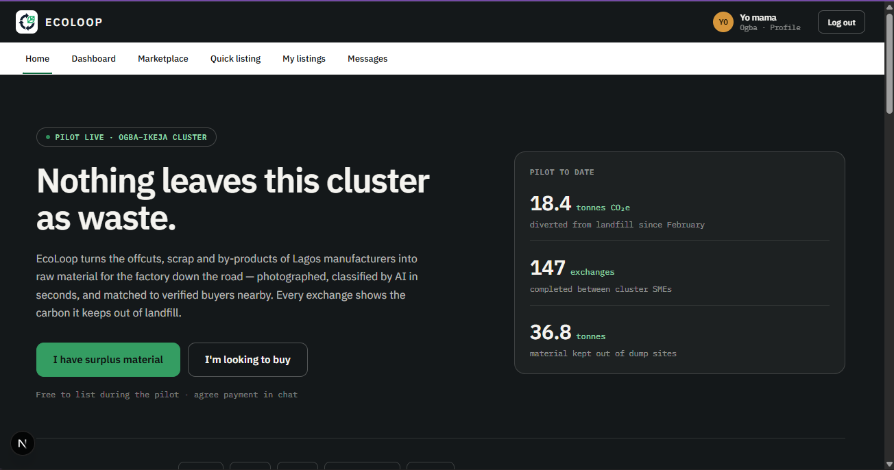
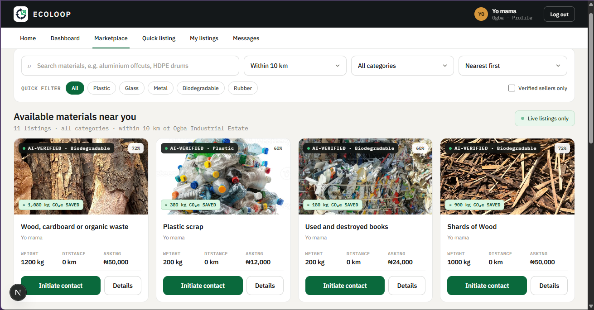
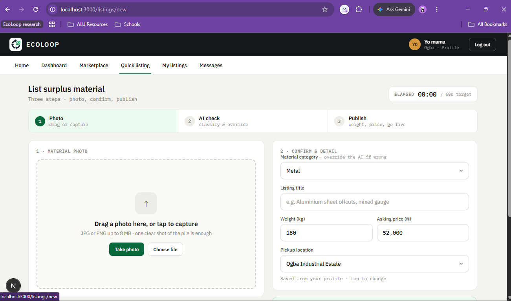

# EcoLoop

AI-powered marketplace that helps factories in Lagos sell their scrap and surplus materials to other factories nearby, instead of dumping them.

## Links

| What | Link |
|------|------|
| Video demo | https://www.youtube.com/watch?v=w7FzwgZITX0 |
| Live app (Vercel) | https://ecoloop-hephzibah1.vercel.app/ |
| Technical report (PDF) | [docs/EcoLoop_Technical_Report.pdf](docs/EcoLoop_Technical_Report.pdf) |

## Description

Small and medium manufacturers in the Ogba and Ikeja industrial clusters in Lagos throw away offcuts, scrap, and by-products that other factories could use as raw material. EcoLoop connects them.

A seller takes a photo of their surplus material. An AI model classifies it (Plastic, Glass, Metal, Biodegradable, or Rubber), the seller can override the result, and the listing goes live in the marketplace. Buyers search and filter by material and distance and message the seller. The seller reserves the lot for one buyer, the buyer pays through Paystack (test mode), and the exchange is marked as complete. Every completed exchange records how much CO2e (carbon) was kept out of landfill.

**This first version (MVP) includes:**

- Sign up, log in, forgot password, and company profile (with photo)
- Quick listing flow: upload photo, AI classification with manual override, publish
- Marketplace with search, material filters, distance filter, and verified sellers
- Messaging between buyer and seller, with file attachments and live updates
- Transactions: interest, reserved, completed, with Paystack test-mode payment verified on the server
- Carbon impact tracking and a dashboard
- My listings page with manage, edit, add photos, and delete

## Tech Stack

| Layer | Tool | Why I chose it |
|-------|------|----------------|
| Frontend | Next.js 16, React 19, TypeScript | File-based routing gives clear pages and navigation. TypeScript catches mistakes early. |
| Styling | Tailwind CSS 4 and custom CSS, IBM Plex Sans and Mono | A consistent design system through CSS variables, easy responsive breakpoints. |
| Backend | Next.js API routes (`app/api/classify`, `app/api/paystack/initialize`, `app/api/paystack/verify`) | One project for frontend and backend, simple to run and deploy. |
| Database | Supabase (PostgreSQL) | Hosted database with row level security, so users only see what they should. |
| Auth | Supabase Auth | Secure login and password reset without building it from scratch. |
| File storage | Supabase Storage | Buckets for listing photos, chat attachments, and profile pictures. |
| AI | Hugging Face Inference (`google/vit-base-patch16-224` first, then `yangy50/garbage-classification`) | Pretrained models, so no training is needed. Labels are mapped into 5 EcoLoop categories. |
| Image processing | Sharp | Resizes photos on the server before classification. |
| Payments | Paystack (test mode) | The buyer pays after the seller reserves the lot. The server checks the payment before the exchange can be completed. |
| Realtime | Supabase Realtime | New messages show up without refreshing. |
| Deployment | Vercel and Supabase | Free tiers. The app is live at the link above. |

### Scope of this MVP

**In scope:** auth, profiles, listings, AI classification with override, marketplace filters, messages, transactions and Paystack test-mode payments, carbon impact.

**Out of scope (later):** logistics partners, smart pricing, a chatbot, training a custom model from scratch, dispute handling, chat encryption, and an age check.

### How the AI classification works

1. The seller uploads a photo, which is stored in Supabase Storage.
2. The API route checks that the photo comes from our own storage, resizes it with Sharp, and sends it to Hugging Face. It tries `google/vit-base-patch16-224` first.
3. If that fails, it tries other ways of calling the model, and then `yangy50/garbage-classification`. The model labels are mapped into the 5 EcoLoop categories (for example "beer bottle" becomes Glass and "water bottle" becomes Plastic).
4. Results under 60% confidence are flagged for review, and the seller can always override the category.

## Technical Requirements

| Item | Version or detail |
|------|-------------------|
| Node.js | 20.9 or newer (tested on 22.11) |
| Next.js / React | 16 / 19 |
| Tailwind CSS | 4 |
| Supabase client | `@supabase/supabase-js` 2.x |
| Browser | Any current browser (tested on Chrome and Brave) |
| Hardware | No special hardware. Any computer that can run Node.js and a browser, with an internet connection. |
| Accounts | Supabase, Hugging Face (access token), Paystack (free test keys) |

## Setup Instructions

### 1. Clone the project

```bash
git clone https://github.com/H3PHZY/CAPSTONE_PROJECT.git
cd CAPSTONE_PROJECT
```

### 2. Install packages

```bash
npm install
```

### 3. Set up Supabase

1. Create a new project on supabase.com.
2. Open **SQL Editor** and run each file in `supabase/migrations/` in number order, from `001` to `016`.
3. Open **Table Editor** and check that these tables exist: `profiles`, `listings`, `classifications`, `transactions`, `carbon_records`, `messages`.
4. Open **Storage** and check that these buckets exist: `listing-photos`, `message-attachments`, `profile-avatars`.
5. Open **Project Settings, API** and copy the Project URL, the anon key, and the service role key.

### 4. Add environment variables

Copy the example file, then open the new file and fill in your own values.

```bash
# Mac or Linux
cp .env.example .env.local

# Windows (PowerShell)
copy .env.example .env.local
```

The file should contain:

```bash
# Supabase (Dashboard > Project Settings > API)
NEXT_PUBLIC_SUPABASE_URL=https://YOUR_PROJECT_REF.supabase.co
NEXT_PUBLIC_SUPABASE_ANON_KEY=your_anon_key
PROJECT_URL=https://YOUR_PROJECT_REF.supabase.co

# Paystack (Dashboard > Settings > API Keys, test mode)
NEXT_PUBLIC_PAYSTACK_TEST_KEY=pk_test_your_public_key
PAYSTACK_SECRET_KEY=sk_test_your_secret_key

# Server-only (never expose to the browser)
SUPABASE_SERVICE_ROLE_KEY=your_service_role_key

# Hugging Face: yangy50/garbage-classification
# https://huggingface.co/yangy50/garbage-classification
HF_TOKEN=hf_your_access_token
HF_MODEL_ID=yangy50/garbage-classification
# Optional (paid or dedicated): Deploy > Inference Endpoints > paste URL
# HF_ENDPOINT_URL=https://YOUR-ENDPOINT.REGION.aws.endpoints.huggingface.cloud
```

| Variable | What it is for |
|----------|----------------|
| `NEXT_PUBLIC_SUPABASE_URL` | My Supabase project URL |
| `NEXT_PUBLIC_SUPABASE_ANON_KEY` | My Supabase anon (public) key |
| `PROJECT_URL` | Same as the Supabase URL, used to check image URLs on the server |
| `NEXT_PUBLIC_PAYSTACK_TEST_KEY` | Paystack public test key used by the checkout modal |
| `PAYSTACK_SECRET_KEY` | Paystack secret test key used by the server to verify payments |
| `SUPABASE_SERVICE_ROLE_KEY` | Server-only Supabase key used by the payment API routes |
| `HF_TOKEN` | My Hugging Face access token |
| `HF_MODEL_ID` | `yangy50/garbage-classification` |

Never commit `.env.local`. It is listed in `.gitignore`.

### 5. Allow the password reset link

In Supabase go to **Authentication, URL Configuration** and add these redirect URLs:

```
http://localhost:3000/reset-password
https://ecoloop-hephzibah1.vercel.app/reset-password
```

### 6. Run the app

```bash
npm run dev
```

Open http://localhost:3000, create an account, and you are ready to test.

### Other commands

| Command | What it does |
|---------|--------------|
| `npm run build` | Production build |
| `npm start` | Run the production build |
| `npm run lint` | Check code with ESLint |
| `node --env-file=.env.local tests/concurrency/reserve-race.mjs` | Run the reservation concurrency test (see Testing) |

## Testing

I used two testing strategies. Full steps, results, and screenshots are in the [technical report](docs/EcoLoop_Technical_Report.pdf), and the screenshots are in `docs/testing/`.

**1. Integration and end-to-end payment verification.** A seller reserves a lot for a buyer, the buyer pays with the Paystack test card `4084 0840 8408 4081`, and I check the requests in the browser Network tab and the database with SQL. I also tried bad inputs: no login token, an unknown deal, a made-up payment reference, and re-sending a verification.

**2. Concurrency and lot locking.** Two buyers contact the same lot and the seller tries to reserve both. The database allows only one. This was tested by hand with two browser tabs and with a script that sends both reservations at the same instant.

To run the script, add these lines to `.env.local` (use a seller account that owns the listing, and the user ids of two buyers who contacted it):

```bash
TEST_SELLER_EMAIL=seller_email
TEST_SELLER_PASSWORD=seller_password
TEST_LISTING_ID=listing_id
TEST_BUYER_A_ID=buyer_a_user_id
TEST_BUYER_B_ID=buyer_b_user_id
```

Then run:

```bash
node --env-file=.env.local tests/concurrency/reserve-race.mjs
```

Expected output: one buyer `RESERVED`, the other `REJECTED`, and `PASS: exactly one buyer reserved the lot`.

### Known limitations

- No automated unit tests yet.
- No Paystack webhook yet. Payment is confirmed when the buyer's browser calls the verify route.
- The 75% classification accuracy test on local Lagos images has not been done.
- The carbon estimate does not yet show the planned margin of error.
- Some components, such as the messages page, are large and should be split.
- The six-week pilot with SMEs has not started.

## Project Structure

```
app/                   Pages (App Router), API routes (classify, paystack), global styles
components/            UI by area: home, auth, dashboard, marketplace, listings, messages, payments, profile
lib/                   Supabase client, listings, messages, transactions, classify, carbon, payment helpers
supabase/migrations/   SQL files that build the database (001 to 016)
tests/concurrency/     Reservation race test script
public/assets/         Logo and sample listing images
designs/               Screenshots and mockups
docs/                  Technical report and testing screenshots (docs/testing/)
```

## Designs

### Screenshots of the app

**Home page**



**Marketplace**



**Quick listing**



### Figma mockups

https://www.figma.com/design/aCXrOjGhfNWAcoflulx1PJ/Untitled?node-id=0-1&t=TF2KlRKGlA5m9qLC-1

### Style guide

| Item | Value |
|------|-------|
| Heading and body font | IBM Plex Sans |
| Numbers and labels font | IBM Plex Mono |
| Background | `#f4f3ef` (warm off white) |
| Text | `#16191a` |
| Muted text | `#6f6e65` |
| Dark header | `#14181a` |
| Primary green | `oklch(0.46 0.11 155)` |
| Accent amber | `oklch(0.72 0.13 72)` |
| Corner radius | 14px cards, 9px small elements |

Design choices:

- **Two bars at the top.** A dark header holds the logo and account. A white bar below it holds the main navigation: Home, Dashboard, Marketplace, Quick listing, My listings, Messages. The current page is underlined in green.
- **Green means action.** Main buttons ("Initiate contact", "Publish", "New listing") are green. Secondary buttons are outlined.
- **Quick listing is a 3 step flow**, because the goal is to list material in under 60 seconds.
- **Labels on cards** show the AI category, confidence, weight, distance, asking price, and CO2e saved so buyers can decide quickly.

## Frontend Code Highlights

**Responsive design.** Media queries in `app/globals.css` simplify the header and navigation on small screens:

```css
@media (max-width: 720px) {
  .app-header { padding: 0 16px; }
  .app-user-meta { display: none; }
  .app-nav { padding: 0 12px; }
}
```

**Navigation defined in one place.** `lib/navigation.ts` holds the links, and the nav component renders them:

```ts
export const NAV_LINKS = [
  { href: "/", label: "Home" },
  { href: "/dashboard", label: "Dashboard" },
  { href: "/marketplace", label: "Marketplace" },
  { href: "/listings/new", label: "Quick listing" },
  { href: "/listings/mine", label: "My listings" },
  { href: "/messages", label: "Messages" },
  { href: "/impact", label: "Carbon impact", feature: "carbonImpact" as const },
] as const;
```

**State handling in the quick listing flow** (`components/listings/QuickListingPage.tsx`). React state tracks the upload, the AI result, the manual override, and the publish step:

```tsx
const [stage, setStage] = useState<Stage>("idle");
const [aiLabel, setAiLabel] = useState<MaterialCategory>("Metal");
const [aiConfidence, setAiConfidence] = useState(0);
const [override, setOverride] = useState<MaterialCategory>("Metal");
const [overridden, setOverridden] = useState(false);
const [publishing, setPublishing] = useState(false);
```

## Backend Code Highlights

**API endpoint** (`app/api/classify/route.ts`). It validates the request, checks that the image comes from our own Supabase storage, then calls the classifier:

```ts
export async function POST(request: Request) {
  let body: Body;
  try {
    body = (await request.json()) as Body;
  } catch {
    return NextResponse.json({ error: "Invalid JSON body" }, { status: 400 });
  }

  const imageUrl = body.imageUrl?.trim();
  if (!imageUrl) {
    return NextResponse.json({ error: "imageUrl is required" }, { status: 400 });
  }
  // ...host check against NEXT_PUBLIC_SUPABASE_URL / PROJECT_URL...
  const result = await classifyListingImage(imageUrl);
  return NextResponse.json(result);
}
```

**Server-side logic: carbon calculation** (`lib/carbon.ts`). Each material has a CO2e factor per kg:

```ts
export const CO2: Record<MaterialCategory, number> = {
  Metal: 4.2,
  Plastic: 1.9,
  Glass: 0.6,
  Biodegradable: 0.9,
  Rubber: 2.4,
};

export function co2FromWeight(weight: number, material: MaterialCategory): number {
  return Math.round(weight * (CO2[material] ?? 1));
}
```

The figures are estimates, not certified offsets.

**Distance between buyer and seller** (`lib/listings.ts`) uses the haversine formula:

```ts
export function haversineKm(a: { lat: number; lng: number }, b: { lat: number; lng: number }): number {
  const R = 6371;
  const dLat = toRad(b.lat - a.lat);
  const dLng = toRad(b.lng - a.lng);
  const lat1 = toRad(a.lat);
  const lat2 = toRad(b.lat);
  const h =
    Math.sin(dLat / 2) ** 2 +
    Math.cos(lat1) * Math.cos(lat2) * Math.sin(dLng / 2) ** 2;
  return R * 2 * Math.atan2(Math.sqrt(h), Math.sqrt(1 - h));
}
```

**Payments.** The buyer never sends a price. `/api/paystack/initialize` checks the login, creates a payment reference on the server, and returns the amount from the database. `/api/paystack/verify` asks Paystack to confirm the payment, checks the reference and amount, and then records it in the database. The database also blocks a second reserved buyer for the same lot (migration 016).

**Database interactions.** `lib/listings.ts`, `lib/messages.ts`, and `lib/transactions.ts` use the Supabase client for creating listings, sending messages, and completing exchanges (`markAsAgreed`, `markExchangeCompleted`, `fetchCarbonImpact`).

**Security.** Row level security is on for every table. For example, buyers and sellers only see their own transactions:

```sql
create policy "Transaction parties can read"
  on public.transactions for select
  to authenticated
  using (buyer_id = auth.uid() or seller_id = auth.uid());
```

**Enums:**

- `material_category`: Plastic, Glass, Metal, Biodegradable, Rubber
- `listing_status`: Draft, Live, Reserved, Sold
- `transaction_status`: Interest, Reserved, Completed, Cancelled

**Storage buckets:** `listing-photos`, `message-attachments`, `profile-avatars`

The full SQL is in `supabase/migrations/` (16 files).

## Deployment

The app is deployed on Vercel at https://ecoloop-hephzibah1.vercel.app/ and uses a hosted Supabase project.

**Production environment variables:** `NEXT_PUBLIC_SUPABASE_URL`, `NEXT_PUBLIC_SUPABASE_ANON_KEY`, `PROJECT_URL`, `SUPABASE_SERVICE_ROLE_KEY`, `NEXT_PUBLIC_PAYSTACK_TEST_KEY`, `PAYSTACK_SECRET_KEY`, `HF_TOKEN`, `HF_MODEL_ID`

Payments run in Paystack test mode only. No real money moves.

## Author

Hephzibah Ofomi, Software Engineering, African Leadership University
Supervisor: Hubert Apana