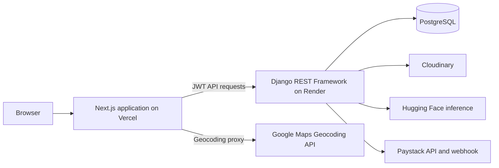
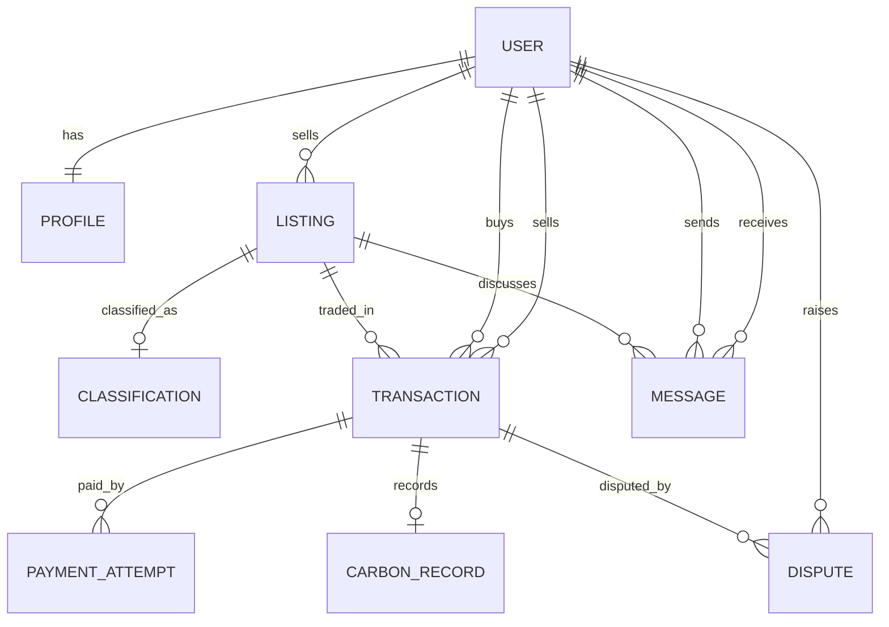
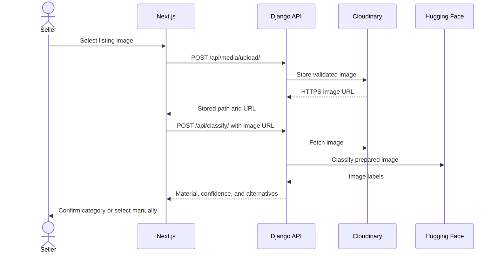

# EcoLoop architecture

## System architecture



## Entity relationships



## Payment sequence

```mermaid
sequenceDiagram
  actor Buyer
  participant Web as Next.js
  participant API as Django API
  participant DB as PostgreSQL
  participant Paystack
  Buyer->>Web: Start checkout
  Web->>API: POST /api/pay/initialize/
  API->>DB: Lock listing; expire holds; save amount snapshot and PaymentAttempt
  API-->>Web: Reference, amount, and transaction ID
  Web->>Paystack: Initialize checkout
  Paystack-->>Web: Checkout result
  Web->>API: POST /api/pay/verify/
  API->>DB: Find attempt by immutable reference
  API->>Paystack: Verify reference, exact amount, NGN, and success
  Paystack-->>API: Successful transaction details
  API->>DB: Fulfil once; signal marks listing sold and creates carbon record
  API-->>Web: Verified payment
  opt Buyer closes checkout before payment
    Web->>API: POST /api/transactions/{id}/cancel/
    API->>DB: Cancel attempt and release listing
  end
  opt Successful payment arrives after hold expiry
    Paystack->>API: Signed charge.success webhook
    API->>DB: Fulfil if available; otherwise mark reconciliation and open dispute
  end
```

## Classification sequence



## Requirements and verification

| Kind | Requirement | Feature | Automated test or validation |
|---|---|---|---|
| Functional | Users can register, sign in, reset passwords, and retain sessions | JWT authentication and refresh | `test_signup_endpoint`, `test_login_endpoint`, `test_password_reset_request_and_confirmation`; frontend auth-context tests |
| Functional | Users may only access their own private records and listings they are permitted to see | Queryset scoping and object permissions | `test_user_cannot_access_another_users_private_listing_or_message`, `test_auth_me_only_exposes_and_updates_authenticated_users_profile` |
| Functional | Sellers may save private drafts and publish them later | Draft listing status and publish action | `test_draft_listings_are_private_until_owner_publishes` |
| Functional | A listing cannot have multiple active deals | Partial unique transaction constraint | `test_partial_unique_constraint_allows_only_one_active_listing_deal` |
| Functional | Payment must be verified before completion | Immutable payment-attempt references, exact amount/currency checks, and idempotent fulfillment | `test_paystack_verification_completes_only_initialized_payment_once`, webhook tests, `test_manual_completion_requires_payment_and_succeeds_after_payment` |
| Functional | Abandoned checkout can be cancelled and holds expire | Explicit cancel action and lazy expiry on initialization and list reads | `test_buyer_can_cancel_unpaid_checkout_and_release_listing`, `test_expired_payment_hold_is_released_during_listing_and_transaction_reads` |
| Functional | Late successful payments are never dropped | Fulfil if still available; otherwise retain a reconciliation attempt and open dispute | `test_late_payment_after_expiry_fulfils_if_listing_is_available`, `test_late_payment_for_a_re_reserved_listing_is_audited_for_reconciliation` |
| Functional | Buyers can raise disputes on paid deals; admins resolve them | Dispute API and Django admin | `test_open_dispute_can_only_be_raised_by_buyer_on_paid_transaction`, `test_dispute_blocks_manual_status_changes` |
| Functional | Listing and profile locations have valid coordinates | Serializer validation and database constraints | `test_listing_location_requires_resolved_coordinates`, `test_profile_location_updates_require_coordinate_pair` |
| Functional | Uploaded images and PDFs persist in media storage | Cloudinary image/raw storage | `test_cloudinary_upload_command_checks_https_urls`; manual `test_cloudinary_upload` command with production credentials |
| Non-functional | Payment data cannot be altered through generic transaction writes | Read-only transaction viewset | `test_transaction_standard_writes_are_disabled_for_buyer_and_seller` |
| Non-functional | Input and stored values obey domain limits | Database constraints, shared image validation, authenticated classification, and safe public-URL fetching | `test_database_check_constraints_reject_invalid_values`, `test_media_upload_rejects_oversized_unsupported_and_fake_images`, `test_classification_requires_auth_and_rejects_private_image_hosts` |
| Non-functional | Credentials and refresh sessions remain protected | Current-password verification, refresh rotation/blacklisting, scoped throttles | `test_credential_updates_require_current_password_and_rotate_tokens`, `test_logout_blacklists_all_refresh_tokens`; frontend JWT refresh tests |
| Non-functional | Authentication/payment endpoints resist repeated requests | DRF scoped throttles | Django settings check; endpoint throttle integration tests |
| Non-functional | Production transport uses HTTPS security settings and exact frontend origins | Django deployment settings | `python manage.py check --deploy` with production environment variables |
| Non-functional | A sleeping API can be monitored without database access | `/api/health/` | `test_health_endpoint_does_not_require_authentication` |
| Non-functional | Backend and frontend changes are checked on each push and pull request | GitHub Actions | `.github/workflows/ci.yml` |

## Coverage notes

The latest backend coverage run reported 82% overall coverage. Coverage remains notably lower in `api/classify.py` (17%), `api/permissions.py` (45%), and `api/views.py` (67%). These modules need additional provider, permission-matrix, and endpoint-branch tests; passing the current suite does not imply those paths are comprehensively covered.
